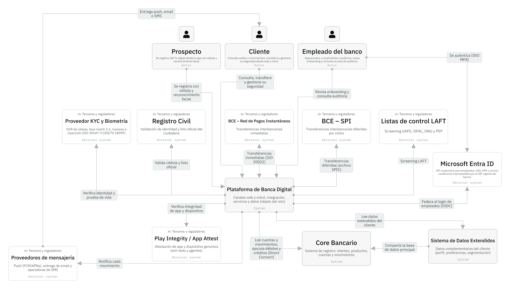
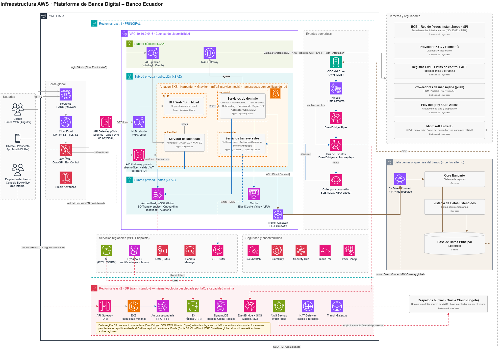

# Plataforma de banca digital - Banco Ecuador

Mi propuesta para el reto técnico de Arquitecto de Soluciones. El objetivo es una plataforma de banca en línea (web y móvil) donde los clientes consulten sus movimientos, hagan transferencias propias e interbancarias, y donde una persona nueva pueda abrir su cuenta desde el celular con reconocimiento facial.

Modelo C4 navegable en IcePanel: https://s.icepanel.io/8it5iVKhNeTy2G/qBcE

## La propuesta en pocas líneas

- Nube: AWS, con us-east-1 como región principal y us-east-2 para DR. Los servicios corren en EKS; los datos en Aurora PostgreSQL, ElastiCache y DynamoDB.
- Integración: dos API Gateway (uno público para clientes y uno privado para el backoffice) y un BFF por canal que orquesta los microservicios. El backend es Java 25: Spring Boot 4.1 WebFlux para los BFF y el dominio, y Quarkus 3.40 en modo nativo para Notificaciones y Auditoría.
- Transferencias: **saga orquestada con idempotencia y outbox**. Según el destino van por el core (propias), por la Red de Pagos Instantáneos del BCE (ISO 20022) o por el SPI.
- Eventos: EventBridge y SQS. Los cambios del core se capturan con AWS DMS.
- Identidad: OAuth 2.0 Authorization Code + PKCE con perfil FAPI 2.0. Keycloak 26.8 para clientes y Entra ID para empleados; ambos se pueden cambiar por el IdP que el banco ya tenga.
- Onboarding: KYC con prueba de vida certificada y validación contra el Registro Civil. Para el ingreso diario, passkeys con la huella o el Face ID del teléfono.
- Notificaciones: push y correo, con SMS solo como respaldo. Se generan desde los cambios del core, así que cubren también cajero y ventanilla.
- Auditoría: base de solo inserción con hash encadenado y archivo en S3 Object Lock.
- Caché: Cache-Aside con Valkey (LFU) para los clientes que más consultan. **El saldo nunca se cachea.**
- Frontend: Angular 22 para web y Flutter 3.47 para móvil. Evalué también React + React Native.
- DR: cuatro niveles de criticidad (T0 a T3). Lo crítico se recupera en 15 minutos o menos y casi sin pérdida de datos. Además hay respaldos inmutables fuera de AWS, en Oracle Cloud Bogotá.

## Diagramas

El modelo completo está en [IcePanel](https://s.icepanel.io/8it5iVKhNeTy2G/qBcE), donde se puede navegar de contexto a contenedores y componentes. Aquí van las exportaciones.

### Nivel 1: contexto

### Nivel 2: contenedores

### Nivel 3: componentes
- [BFF Móvil (orquestación)](c4/diagramas/03-componentes-bff-movil.png)
- [Servicio de Transferencias](c4/diagramas/03-componentes-transferencias.png)
- [Servicio de Clientes (caché)](c4/diagramas/03-componentes-clientes-cache.png)
- [Servicio de Auditoría](c4/diagramas/03-componentes-auditoria.png)

### Infraestructura AWS

La fuente editable está en [`infra/infraestructura-aws.drawio`](infra/infraestructura-aws.drawio).

## Documentos

1. [Justificación de las decisiones](docs/01-justificaciones.md): qué elegí, por qué y qué descarté.
2. [Consideraciones técnicas](docs/02-consideraciones-tecnicas.md): normativa, alta disponibilidad, DR, seguridad, escalabilidad y regiones.
3. [Glosario](docs/03-glosario.md): siglas y términos menos comunes.
4. [Tecnologías, versiones y riesgos](docs/04-tecnologias-y-riesgos.md).
5. [Decisiones de arquitectura (ADR)](docs/adr/README.md).

## Criterio general

Prioricé servicios administrados y estándares abiertos sobre productos, porque un banco mediano no tiene un equipo grande de operación y necesita poder cambiar de proveedor. Muchas decisiones (Entra ID para empleados, contract-first con OpenAPI, una capa anticorrupción frente al core) vienen de lo que he visto funcionar en proyectos de modernización en banca, donde **el core legado y los proveedores externos suelen ser la parte más difícil de integrar**.

## Supuestos

Asumí un banco mediano con un core genérico on-premise, junto con un sistema complementario de datos y la base de datos principal, que es lo más común en Ecuador. La plataforma no reemplaza al core: **el core sigue siendo la fuente de verdad de saldos y movimientos**.

## Pendientes de validar con el banco

Hay decisiones que dependen de información que el reto no da. **Las dejo planteadas en lugar de asumirlas:**

- Si el proveedor del core permite leer los logs de su base de datos. De eso depende usar CDC con DMS o pedirle eventos al proveedor.
- La posición de la Superintendencia de Bancos sobre procesar datos de clientes en una región de EE. UU., aunque estén cifrados con llaves del banco.
- El proveedor de KYC. Facephi, FaceTec e iProov cumplen las certificaciones; la elección final depende de costo por verificación, presencia local y que tenga SDK para Flutter.
- Volumen real de transacciones y picos (fin de mes, décimos). Con eso se dimensiona EKS y se confirma que EventBridge + SQS es suficiente.
- Si el banco ya tiene un IdP para clientes o un contrato vigente con Microsoft, lo que podría cambiar Keycloak o confirmar Entra ID.
