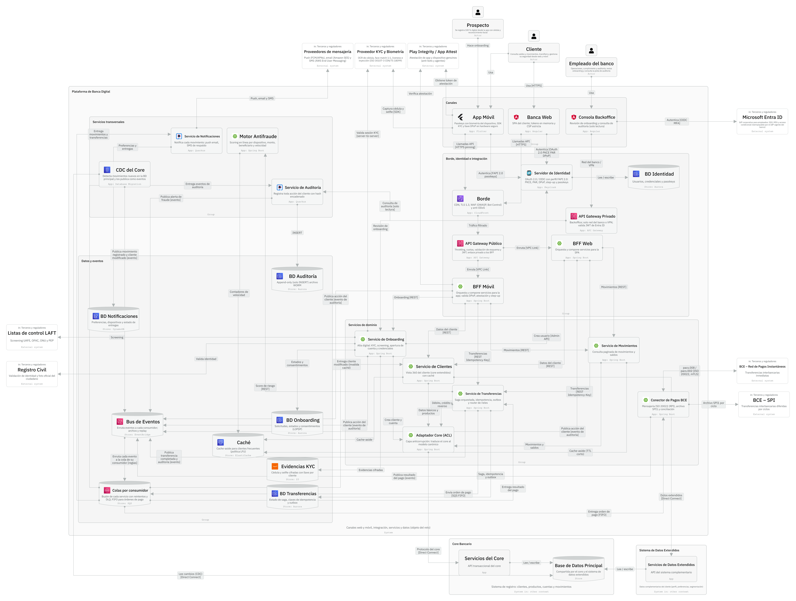
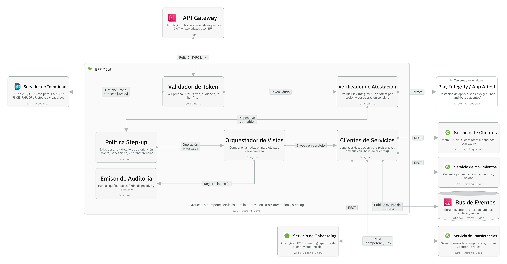
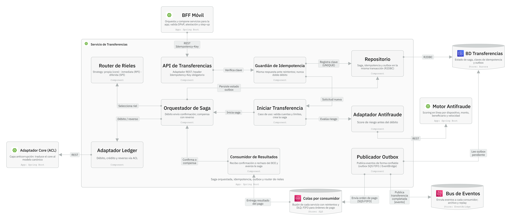
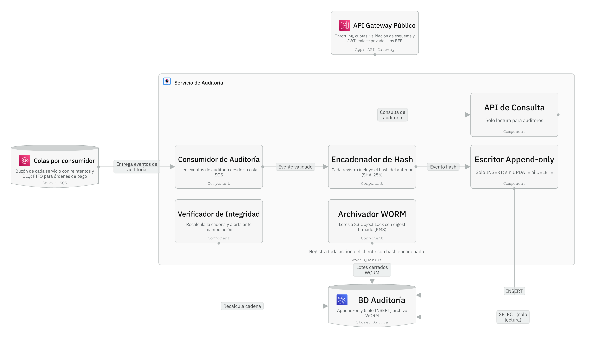
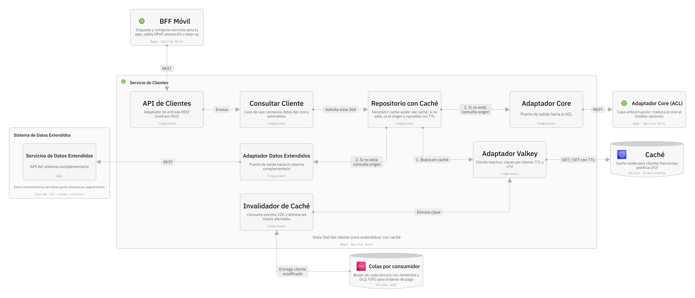

# 01. Justificación de las decisiones de diseño

Este documento resume las decisiones principales: qué elegí, por qué y qué dejé fuera. No entra en detalle de implementación; eso corresponde a la fase de diseño detallado. Las decisiones formales están en los [ADR](adr/README.md), las versiones y riesgos de cada tecnología en el [documento 04](04-tecnologias-y-riesgos.md) y las siglas en el [glosario](03-glosario.md).

## Supuestos

- Un banco mediano, del tamaño de una cooperativa grande o un banco no sistémico.
- Core bancario genérico on-premise, como en la mayoría de entidades del país, con un sistema complementario y una base de datos principal compartida.
- La plataforma no reemplaza al core. El core sigue siendo la fuente de verdad de saldos y movimientos.

## 1. Integración: API Gateway y BFF

El reto pide un API Gateway que orqueste los servicios de clientes, movimientos y transferencias. Separé esa responsabilidad en dos piezas. Amazon API Gateway se encarga de lo transversal (throttling, cuotas, validación del contrato y del token, enlace privado hacia los servicios), y la orquestación vive en un BFF por canal: BFF Web y BFF Móvil. Poner lógica de negocio en el gateway es una práctica que termina acoplando el negocio a la infraestructura, y cada canal necesita respuestas distintas.

Usé dos gateways. El público atiende a clientes web y móvil. El privado es solo para el backoffice y solo se alcanza desde la red del banco o por VPN, así las APIs administrativas nunca quedan expuestas a internet. El login no pasa por ninguno de los dos: CloudFront y WAF envían el flujo OAuth a un balanceador que solo expone Keycloak.

Además de los tres servicios que pide el reto, agregué:

- Onboarding, para el alta digital.
- Conector de Pagos BCE, que aísla la mensajería con el Banco Central.
- Adaptador del Core, una capa anticorrupción (ACL) para que el modelo del core no se filtre al resto de servicios.
- Notificaciones y Auditoría, que también exige el reto.

Todo el backend está en Java 25. Los BFF y los servicios de dominio usan Spring Boot 4.1 con WebFlux, porque son los que más llamadas concurrentes hacen y el modelo reactivo rinde mejor con menos recursos. Notificaciones y Auditoría usan Quarkus 3.40 compilado a imagen nativa: son servicios simples y de alto volumen, arrancan en milisegundos y consumen poca memoria. Un solo lenguaje significa un mismo equipo, las mismas librerías de seguridad y observabilidad y un solo pipeline de análisis de código.

Todos los servicios siguen arquitectura hexagonal. Si mañana cambia el core o un proveedor, se cambia un adaptador y no el dominio.

## 2. Transferencias

Una transferencia interbancaria pasa por el core y por el BCE, y no hay una transacción que abarque ambos. Por eso usé una saga orquestada: el servicio registra cada paso y, si algo falla después del débito, compensa con un reverso.

Otros dos cuidados:

- Cada solicitud lleva un `Idempotency-Key`. Si la app reintenta por un timeout, el débito no se repite.
- El cambio de estado y el evento se guardan en la misma transacción (outbox), así no se pierden eventos si el servicio cae justo después de confirmar.

Un router de rieles (patrón Strategy) decide por dónde sale cada transferencia: las propias se resuelven en el core, las inmediatas van por la Red de Pagos Instantáneos del BCE con mensajería ISO 20022, y las diferidas por el SPI. Agregar otro riel, por ejemplo una red privada como Banred, es agregar una estrategia.

## 3. Autenticación y autorización

Propongo OAuth 2.0 Authorization Code + PKCE con el perfil FAPI 2.0, que es el que se usa en Open Banking. En la práctica eso suma:

- PAR: los parámetros de autorización viajan por un canal servidor a servidor y no por el navegador.
- DPoP: el token queda ligado a una llave del dispositivo. Si alguien lo roba, no le sirve en otro equipo.
- Step-up: para transferir se pide una autenticación más fuerte.
- Atestación de la app (Play Integrity y App Attest) más WAF con Bot Control, contra bots y automatización con IA.

Para clientes elegí Keycloak: soporta FAPI 2.0, DPoP y passkeys, corre dentro de la nube del banco y no tiene costo por usuario. Para empleados, Microsoft Entra ID, que es el IdP corporativo más común en la banca del país y ya trae SSO, MFA y acceso condicional. Si el banco ya tiene otro IdP, se puede usar en lugar de cualquiera de los dos después de evaluar su soporte de estándares, costo y continuidad; la arquitectura solo depende de OIDC y OAuth 2.0.

Descarté Amazon Cognito por su soporte limitado de FAPI 2.0, y usuario + contraseña + SMS OTP porque no resiste phishing.

## 4. Onboarding y biometría

La biometría aparece en dos momentos distintos y conviene no mezclarlos.

En el onboarding, que ocurre una sola vez, la persona toma foto de su cédula y una selfie con prueba de vida. La selfie se compara con la foto del Registro Civil, se hace el screening LAFT (UAFE, OFAC, ONU, PEP) y se registran los consentimientos de la LOPDP. Para esto se contrata un proveedor especializado (Facephi, FaceTec o iProov) que tenga certificación ISO 30107-3 contra fotos y máscaras, y CEN/TS 18099 contra ataques de inyección como los deepfakes.

En el ingreso diario se usan passkeys (FIDO2) que el cliente desbloquea con su huella o Face ID. La biometría la valida el sistema operativo del teléfono y nunca sale del dispositivo. Usuario, contraseña y OTP quedan solo como respaldo.

## 5. Notificaciones

El canal principal es push (FCM en Android y APNs en iOS), porque es inmediato, cifrado hasta la app y barato. El correo (Amazon SES) también es principal porque le deja al cliente un registro. El SMS queda como respaldo cuando el push no llega, y nunca lleva enlaces, para no entrenar al cliente a abrir links que podrían ser fraude.

Lo importante es de dónde salen los avisos: de los cambios en la base del core, capturados con CDC (AWS DMS). Si dependieran solo de la app, no se notificarían los movimientos hechos en cajero o ventanilla.

## 6. Eventos asíncronos

EventBridge recibe eventos como "transferencia completada" o "movimiento registrado" y los entrega a cada servicio interesado. También permite archivar y volver a enviar eventos si hay que reprocesar. Cada consumidor tiene su cola SQS, con reintentos y cola de errores, para que un servicio caído no pierda mensajes. Las órdenes de pago usan colas FIFO para respetar el orden.

No usé Kafka. Para el volumen de un banco mediano es más de lo necesario y exige operar y dimensionar un clúster. EventBridge y SQS son administrados y se pagan por uso.

## 7. Auditoría y caché

Cada acción del cliente se publica como evento: quién, qué, cuándo, desde qué dispositivo y con qué resultado. El servicio de Auditoría la guarda en una base de solo inserción donde cada registro lleva el hash del anterior; si alguien altera un registro, la cadena se rompe y se detecta. Periódicamente se archiva en S3 con Object Lock, que impide modificar o borrar. Consideré Amazon QLDB, pero AWS ya no le da soporte.

Para los clientes frecuentes usé Cache-Aside sobre ElastiCache (Valkey) con política LFU, que mantiene en memoria a quienes más consultan sin lógica adicional. La caché se implementa como un Decorator sobre el repositorio, así el dominio no sabe que existe. Se invalida con los eventos de cambio del core. El saldo disponible no se cachea nunca.

## 8. Frontend

Evalué dos opciones:

| | Angular 22 + Flutter 3.47 (elegida) | React + React Native |
|---|---|---|
| A favor | Angular trae estructura definida, TypeScript obligatorio y protecciones contra XSS integradas, y es muy usado en banca. Flutter compila a nativo y tiene buena presencia en fintech. | El ecosistema y la oferta de talento más grandes, y un solo lenguaje. |
| En contra | Curva de aprendizaje alta y dos lenguajes (TypeScript y Dart). | Menos estructura: cada equipo toma más decisiones y es fácil perder consistencia. |

Elegí la primera porque una banca en línea es una aplicación transaccional detrás de un login, donde pesan más la consistencia y la seguridad que la flexibilidad. Los dos lenguajes se compensan trabajando contract-first: los contratos OpenAPI generan los clientes de web y móvil. Los riesgos de mantenimiento, como las migraciones de versión de Angular, están en el [documento 04](04-tecnologias-y-riesgos.md#frontend).

## 9. Patrones usados

Arquitectura hexagonal, Backend for Frontend, Anti-Corruption Layer, Saga orquestada, Transactional Outbox, Idempotent Receiver, Strategy, Cache-Aside con Decorator, Change Data Capture, Circuit Breaker con reintentos y timeouts, y Publish-Subscribe.
