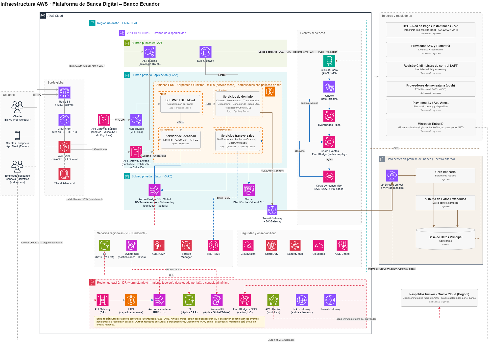

# 02. Consideraciones técnicas

## 1. Normativa

| Norma | Cómo se atiende |
|---|---|
| LOPDP y su reglamento | Consentimientos por finalidad, minimización de datos y canal para ejercer derechos. AWS actúa como encargado del tratamiento mediante contrato y cláusulas tipo. La SPDP ha aclarado que tener un encargado fuera del país no convierte por sí solo el tratamiento en una transferencia internacional. |
| Derecho de supresión | Cada cliente tiene su propia llave de datos (envelope encryption). En AWS KMS hay pocas llaves maestras, que cifran las llaves de los clientes; estas se guardan en un almacén de llaves aparte, una tabla DynamoDB replicada con Global Tables a la que solo accede el componente de cifrado. Para borrar a un cliente se destruye su llave y sus datos quedan ilegibles, incluso en respaldos inmutables. Los respaldos del almacén de llaves se retienen como máximo 35 días, que es el plazo de borrado que se declara en la política de privacidad. |
| Superintendencia de Bancos (riesgo operativo, ciberseguridad, continuidad) | Plan de continuidad con RTO y RPO por nivel, pruebas periódicas de DR, gestión de proveedores críticos y monitoreo permanente. |
| Banco Central (SPI y Red de Pagos Instantáneos) | Conector dedicado con mensajería ISO 20022 y conciliación diaria. |
| LAFT / UAFE | Screening en el onboarding y monitoreo antifraude de las transacciones. |
| PCI-DSS 4.0.1 | Aplica solo si se manejan datos de tarjeta. El alcance se reduce con tokenización: el número de tarjeta nunca entra a la plataforma. |
| ISO/IEC 27001 | Marco del sistema de gestión de seguridad de la información. |

## 2. Alta disponibilidad y tolerancia a fallos

Dentro de la región principal, EKS, Aurora y ElastiCache se reparten en tres zonas de disponibilidad. EventBridge y SQS ya son regionales.

En el código se usa Resilience4j para circuit breaker, timeouts y reintentos. **Lo que no tiene que ser inmediato va por eventos**: si Notificaciones o Auditoría se caen, los mensajes esperan en SQS y se procesan cuando vuelven.

La conexión con el core usa dos enlaces Direct Connect más una VPN de respaldo, hacia el data center principal y el alterno del banco.

### Qué pasa si se cae el core

El banco tiene un solo core, con su propia alta disponibilidad (clúster, réplica de base y centro alterno). **La plataforma no lo duplica; lo aísla para que una caída no se propague.**

El circuit breaker del Adaptador Core deja de llamar al core y responde "no disponible" de inmediato, en lugar de acumular solicitudes colgadas. El adaptador apunta a una dirección única (DNS o IP virtual), así que si el banco activa su centro alterno, la plataforma lo sigue sin cambios.

| Función | Con el core caído |
|---|---|
| Login | Sigue funcionando, Keycloak no depende del core. |
| Perfil y últimos movimientos | Se muestran desde la caché, con la hora de la información. |
| Saldo disponible | "Temporalmente no disponible", porque el saldo no se cachea. |
| Transferencias inmediatas | Se rechazan con un mensaje claro. |
| Transferencias programadas | Quedan registradas y se ejecutan cuando el core vuelve. |
| Onboarding | KYC y screening continúan; la apertura de la cuenta queda en espera. |
| Notificaciones | Se pausan y luego se reanudan sin pérdida, porque el CDC continúa desde su último punto de lectura. |

Si el core fuera un SaaS del proveedor, la disponibilidad y el DR se exigirían por contrato (SLA, RTO y RPO), el CDC se reemplazaría por los eventos que publique el proveedor y el adaptador permitiría cambiar de proveedor sin tocar lo demás. Ante la Superintendencia se manejaría como riesgo de tercero, con plan de salida.

## 3. Recuperación ante desastres

No todos los servicios necesitan recuperarse igual de rápido, así que los dividí en cuatro niveles:

| Nivel | Servicios | RPO | RTO | Estrategia |
|---|---|---|---|---|
| T0 | Identidad, transferencias, auditoría | Casi cero | 15 min o menos | Warm standby en us-east-2 (Aurora Global Database) |
| T1 | Consultas y notificaciones | 1 min o menos | 30 min o menos | Warm standby |
| T2 | Onboarding y backoffice | 15 min o menos | 4 h o menos | Pilot light (datos replicados, cómputo bajo demanda) |
| T3 | Reportes | 24 h | 24 h | Backup & restore |

Perder una transferencia confirmada es un problema financiero y regulatorio; un reporte puede esperar un día. **Con niveles, el costo del DR es proporcional a lo que cada servicio aporta.**

Los respaldos se hacen con AWS Backup en otra región y otra cuenta, en bóvedas inmutables, como protección contra ransomware.

Además, una copia inmutable de esos respaldos se envía a Oracle Cloud en Bogotá. Es la protección para el caso extremo de perder AWS completo (un ataque masivo a la cuenta, una sanción o un conflicto con el proveedor). Las llaves de cifrado de esa copia se custodian también fuera de AWS, en un HSM del banco o en el vault de Oracle; sin ellas la copia sería ilegible. **Hay que ser claro con lo que cubre: protege los datos, no la continuidad del servicio.** Reconstruir la plataforma en otra nube tomaría días.

La conmutación entre regiones es controlada, con Route 53 ARC, y los simulacros de DR se hacen cada seis meses.

## 4. Seguridad y monitoreo

- En tránsito: TLS 1.3, mTLS entre servicios y con el BCE, y certificate pinning en la app.
- En reposo: todo se cifra con llaves KMS del banco, y los datos personales sensibles además a nivel de campo.
- En EKS hay un namespace por grupo (bff, dominio, identidad, transversales) con políticas de red y mTLS entre servicios.
- Accesos con mínimo privilegio en IAM, cuentas AWS separadas por entorno, y empleados entrando con Entra ID y MFA.
- Desarrollo seguro siguiendo OWASP ASVS y API Security Top 10, con análisis de código y dependencias (Checkmarx y Snyk) en el pipeline.
- Monitoreo con CloudWatch y OpenTelemetry, más GuardDuty, Security Hub, CloudTrail y AWS Config. Las alertas se definen sobre objetivos de nivel de servicio (SLO).

## 5. Escalabilidad y desacoplamiento

Un servicio nuevo no obliga a tocar los existentes: se suscribe a los eventos que necesita en EventBridge o se expone detrás de los BFF. Las APIs se definen contract-first con OpenAPI, se versionan y tienen pruebas de contrato.

Cada servicio escala por su cuenta en EKS, con Karpenter agregando nodos según la carga. EventBridge y SQS escalan solos. WebFlux permite atender más solicitudes con menos recursos, y los servicios en Quarkus nativo arrancan en milisegundos, lo que ayuda en picos como las ráfagas de notificaciones de fin de mes.

## 6. Nube, regiones y latencia

AWS no tiene región en Ecuador. Estas son las opciones que comparé:

| Opción | Decisión |
|---|---|
| us-east-1 (Virginia) | Región principal. Tiene todo el catálogo de servicios, el menor costo y buena conectividad desde Ecuador. |
| us-east-2 (Ohio) | Región de DR. Mismo precio y otra zona geográfica. |
| São Paulo | Descartada. Es más cara, la replicación tiene más retraso y, al seguir siendo AWS, no reduce el riesgo de proveedor. |
| Chile | A futuro. Hoy está abierta solo a clientes seleccionados; vale la pena revisarla cuando tenga disponibilidad general, catálogo completo y precios. |
| Multicloud activo (Oracle Bogotá o Santiago) | Descartado para operar. Duplica operación, seguridad y redes. Oracle se usa solo para los respaldos búnker. |

Para la latencia: CloudFront sirve la web desde el borde, la caché evita ir al core en consultas frecuentes, los BFF hacen llamadas en paralelo y la conexión al core es por Direct Connect. **Aun así, la latencia real desde Quito y Guayaquil hay que medirla antes de salir a producción.**
